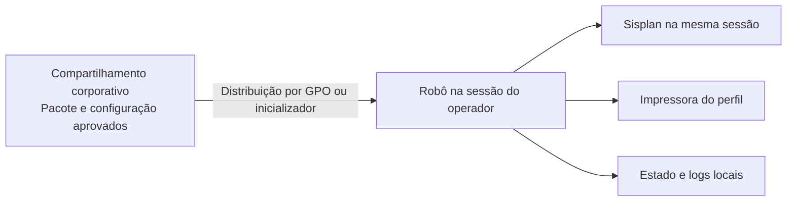

# Centralização das configurações e possibilidade de VM

Análise em 15/10/2026, solicitada para reduzir a configuração manual de cada computador. É uma proposta baseada no código atual e nos registros do estrutura-nunes; não houve acesso aos servidores, criação de VM, implantação de serviço ou alteração de GPO.

A centralização é viável. Para a necessidade declarada, a primeira opção é manter o robô junto ao Sisplan e centralizar configuração e distribuição usando o compartilhamento e o domínio já documentados. Uma VM com serviço central torna-se mais útil se também for necessário compartilhar a mesma fila entre computadores ou manter as credenciais de integração fora das estações.

Confirmações posteriores do responsável em 15/10/2026: o Sisplan está instalado
no próprio computador do operador e o objetivo atual é somente centralizar
configurações. Com essas premissas, recomenda-se manter a execução, a fila e os
logs locais, com pacote e configuração administrados centralmente. Uma VM nova
e a fila compartilhada ficam fora da proposta inicial. Essas respostas delimitam
a análise; não representam autorização para implantar compartilhamentos ou GPOs.

## O que as fontes permitem afirmar

O [inventário de infraestrutura](C:/Users/ADM07/Projetos/Nunes/estrutura-nunes/area-nunes/infraestrutura.md) documenta:

- HOST01 hospedando DC01, TS01 e POWERBI; a ficha histórica informa 32 GB de RAM no host.
- DC01 com Active Directory, arquivos, impressão e compartilhamentos DFS.
- TS01 como Terminal Server com Sisplan e Print Factory.
- GPOs já usadas para distribuir impressoras por usuário/OU.
- Evidências históricas de carga alta e lacunas na comprovação de restauração. Isso não prova a capacidade nem o estado atuais.

Portanto, existem recursos documentados que podem ser reaproveitados; não há evidência suficiente para aprovar outra VM, escolher em qual servidor hospedar um serviço ou dimensionar CPU, memória e disco. A associação do banco Sisplan a um servidor físico também não deve ser presumida.

Os registros de [automações](C:/Users/ADM07/Projetos/Nunes/estrutura-nunes/area-nunes/automacoes.md) conservam uma inspeção anterior do Havan. Nesta análise, o comportamento atual foi conferido no código deste repositório, que já possui persistência de filas, logs com rotação e confirmação de itens. As limitações históricas desses registros não foram tratadas como descrição da versão atual.

## O limite técnico da execução remota

O projeto conecta-se a um processo Windows, localiza controles Win32, muda o foco, clica e envia teclas. Uma execução dentro da VM não passa a acessar os controles de um Sisplan aberto em outro computador apenas porque ambos estão na rede.

Se o Sisplan estiver instalado no computador do operador, essa parte do robô precisa executar ali. Se a janela exibida ao operador vier de uma sessão remota do TS01, a implantação precisa ser avaliada dentro da mesma sessão do TS01. A aparência de uma janela no computador não determina onde o processo realmente executa.

A documentação do [pywinauto sobre execução remota](https://pywinauto.readthedocs.io/en/latest/remote_execution.html) descreve a dependência de uma área de trabalho ativa. Os métodos usados neste projeto, como `click_input`, foco e teclado, sofrem com bloqueio da sessão e, nas condições padrão descritas, minimização/desconexão de RDP. A parte gráfica deve funcionar como aplicativo na sessão interativa, e não como serviço Windows em segundo plano. Não se propõe contornar políticas de bloqueio para viabilizar a VM.

## Comparação das opções

| Opção | Onde o Sisplan e os cliques executam | Benefício | Limite e custo de manutenção |
| --- | --- | --- | --- |
| Configuração e pacote centrais; execução local | Na mesma sessão do Sisplan | Reduz configuração manual e padroniza atualizações com poucas mudanças no projeto | A fila continua local; segredos usados pelo cliente precisam estar acessíveis a ele; não coordena computadores simultâneos |
| Serviço central em VM e componente local | Sisplan e componente gráfico na mesma sessão; serviço sem interface na VM | Pode centralizar filas, downloads, consultas, configurações e credenciais de integração | Exige API autenticada, persistência central, coordenação dos pedidos, tratamento de falha de rede e manutenção do serviço |
| Projeto inteiro e Sisplan em VM Windows | Ambos na mesma sessão da VM | Centraliza também o ambiente de execução | Exige homologação da sessão gráfica, licenças aplicáveis, impressão e recursos; muda a rotina de acesso do usuário |
| Projeto inteiro na VM e Sisplan em outro computador | Processos separados | Não é suportado pelo desenho atual | Exigiria um componente no computador/sessão do Sisplan ou outra integração específica do ERP |

Para centralizar somente configurações, uma VM nova não é necessária por definição: um compartilhamento existente pode resolver a distribuição. Isso não significa instalar novos serviços no controlador de domínio nem aprovar o uso dos servidores atuais sem conferir sua configuração.

## Primeira entrega recomendada: configurações e distribuição centrais

O operador recebe o mesmo atalho e um pacote padronizado. Ao abrir, o programa encontra a configuração central automaticamente, carrega o perfil aplicável e valida as dependências. Alterações comuns são feitas uma vez pela TI.

A Microsoft documenta que [preferências de GPO](https://learn.microsoft.com/en-us/windows-server/identity/ad-ds/manage/group-policy/group-policy-preferences) podem distribuir arquivos, atalhos, variáveis, configurações e conexões de impressoras, com direcionamento por usuário, computador ou grupo. O estrutura-nunes demonstra uso anterior desse mecanismo, mas não confirma quais máquinas e usuários deste robô estão atualmente cobertos por ele.

O desenho proposto separa quatro grupos de dados:

| Grupo | Conteúdo e destino propostos |
| --- | --- |
| Configuração comum | Caminho de arquivos, perfil de integração, versão aprovada e padrões de operação, em fonte central com leitura para operadores e alteração somente pela TI |
| Perfil de operação | Impressora e diferenças justificadas por setor, usuário ou máquina, definidas centralmente; usar um padrão e cadastrar somente as exceções |
| Pacote de execução | Executável e utilitários padronizados em versão homologada, distribuídos para uma pasta local; verificar a possibilidade de redistribuir os utilitários antes de incluí-los |
| Dados de execução | SQLite e logs em pasta local gravável e separada do pacote; XML/PDF podem ter armazenamento central, com permissões e tratamento de indisponibilidade |

O caminho central pode ser informado por uma variável não secreta distribuída por GPO ou por um inicializador instalado uma vez. Esse mecanismo ainda precisa ser implementado: atualmente o programa carrega `config.toml` ao lado do executável, usa constantes carregadas na importação e lê as credenciais do portal do ambiente.

Para reduzir dependências de cada computador, o pacote deve localizar os utilitários em caminhos relativos padronizados e usar um diretório de dados independente da versão do executável. Uma pasta sob `%LOCALAPPDATA%` é uma opção por usuário; uma localização por máquina com permissões adequadas é outra, caso operadores devam compartilhar a fila naquele computador. A escolha deve acompanhar quem é responsável pelas pendências.

Uma mudança de configuração deve valer na próxima abertura ou no próximo lote, sem trocar impressora ou parâmetros durante um pedido em andamento. Configuração inválida ou indisponível deve gerar orientação clara. Não se recomenda uso silencioso de uma configuração antiga quando isso puder direcionar uma importação ou impressão incorretamente.

Distribuir automaticamente não significa eliminar todas as diferenças de ambiente: a impressora ainda precisa estar instalada e acessível na sessão, o Sisplan precisa estar disponível e os caminhos devem ter permissão. A automação pode validar esses requisitos e mostrar ao operador o que falta, sem exigir edição manual de arquivos.

### Credenciais

Centralizar somente o TOML não elimina a configuração das credenciais. O programa ainda precisa do acesso ao portal e ao banco.

Na solução de menor porte, um armazenamento restrito comum poderia fornecer as credenciais necessárias aos clientes autorizados. Isso reduz manutenção, mas os clientes continuam tendo acesso aos segredos usados por eles. Não seria correto afirmar que as senhas ficaram isoladas das estações. Não colocar senhas em GPO/SYSVOL, arquivos públicos, atalhos ou no pacote distribuído.

O JSON privado atual do estrutura-nunes reúne dois perfis, inclusive um identificado na origem como de gravação. Não se recomenda distribuí-lo integralmente. O robô usa consultas e deveria receber um acesso exclusivo para essa finalidade, com permissões efetivas verificadas. A transação somente leitura usada pelo programa não substitui a restrição da conta no servidor.

Se o requisito for manter credenciais de portal e banco fora das estações, a opção adequada é o serviço central descrito a seguir. O componente local ainda precisa de identidade/autorização para acessar esse serviço; não se trata de um cliente sem autenticação.

## Quando o serviço central em VM compensa

Essa alternativa atende um objetivo maior: entrar em outro computador e encontrar a mesma fila, acompanhar o andamento e manter as credenciais de integração no servidor.

O serviço central poderia cuidar de configurações, consultas de leitura ao Sisplan, login/download no portal, arquivos e estado das etapas. O componente local ficaria responsável pela tela do Sisplan, leitura do número interno, envio de comandos autorizados e impressão na sessão do operador. A geração do PDF numerado pode ficar no servidor após a confirmação do número e dos itens.

Essa separação exige mudanças reais no programa. Não basta mover a pasta para a VM. Também não é necessário começar com uma plataforma geral, mensagens distribuídas ou vários serviços: um serviço interno pequeno e um componente local são suficientes como proposta inicial.

Os pontos de integridade que precisam estar no desenho são:

- Identificar qual componente assumiu cada pedido e impedir que dois computadores incluam o mesmo pedido simultaneamente. A consulta prévia ao ERP não é um bloqueio entre executores.
- Preservar o estado antes de comandar a interface e confirmar no banco depois de gravar.
- Após perda de conexão, manter uma inclusão ou impressão incerta para conferência. Expiração de uma reserva não deve liberar automaticamente uma inclusão que pode já ter sido executada.
- Reconciliar o estado local com o central antes de permitir uma retomada por outro computador, inclusive quando uma confirmação enviada pela rede teve resposta perdida.
- Registrar pedido, usuário, computador, sessão, versão e etapa nos diagnósticos, preservando os segredos.
- Prever autenticação, conexão protegida, controle de acesso, backup e recuperação do serviço. Uma falha do serviço central interromperá as máquinas dependentes dele.

O registro central das filas deve pertencer à aplicação, separado das tabelas de negócio do Sisplan. Usar PostgreSQL em um banco da aplicação é uma possibilidade a avaliar; isso não autoriza criar tabelas ou dar privilégios de escrita ao robô na base do ERP. Para um serviço único pequeno, SQLite pode continuar em disco local do servidor, acessado exclusivamente pelo serviço; clientes não abririam seu arquivo pela rede.

### Por que não compartilhar o SQLite atual

Hoje `estado-pedidos.sqlite3`, sua trava e o log ficam na pasta da aplicação. Executar o mesmo pacote diretamente de um compartilhamento faria as máquinas disputar esses arquivos. Copiar o pacote sem separar dados também pode substituir ou fragmentar o histórico durante atualizações.

A documentação do [SQLite sobre acesso por rede](https://www.sqlite.org/useovernet.html) alerta para problemas de sincronização e bloqueio ao abrir o arquivo remoto e recomenda uma interface cliente/servidor quando os dados ficam em outra máquina. A proposta é compartilhar configuração e documentos quando necessário; a fila compartilhada deve ser exposta por um serviço, não por acesso direto dos computadores ao SQLite em SMB/DFS.

Manter SQLite local na primeira entrega significa que Retomar continuará sendo local. Não seria uma fila única entre computadores. Permitir uso em vários computadores também não equivale a homologar execução simultânea: as travas atuais só coordenam a mesma instalação. Até existir coordenação central, o processo precisa continuar restrito a um executor por vez.

## Piloto e decisões que ainda faltam

A escolha inicial recomendada é configuração/distribuição central, mantendo
robô e Sisplan no computador do operador. A fila compartilhada não faz parte
da necessidade atual confirmada. Um serviço em VM só precisa ser reavaliado
se houver mudança de requisito, como isolar as credenciais das estações.

Antes de implantar, confirmar:

1. Qual compartilhamento e grupos de acesso podem receber a configuração e o pacote; qual impressora está realmente disponível à operação.
2. Como o acesso exclusivo de leitura ao banco e as credenciais do portal serão fornecidos. Não é necessário copiar segredos para responder a essas decisões.
3. Como distribuir o pacote e o atalho às estações autorizadas, preservando os dados locais nas atualizações.
4. Se os XML/PDF também serão centralizados ou continuarão locais; essa escolha é separada da centralização das configurações.

Um piloto deve usar uma estação adicional: o operador recebe o atalho, abre sem editar TOML nem criar variáveis manualmente e vê o perfil correto. Testar alteração central da impressora/perfil, falta de acesso à configuração, atualização do pacote sem perda do histórico e diagnóstico de falha. Se houver serviço central, acrescentar disputa entre dois clientes e perda de conexão antes/depois da gravação. Testes de inclusão e impressão reais precisam ter escopo operacional próprio; esta análise não os executou.

Esta proposta não muda a decisão de manter o aviso do Sisplan como última barreira de duplicidade. As verificações no banco e os cuidados de retomada permanecem necessários em qualquer uma das opções.

## Interface web como a do contas-receber

A comparação solicitada em 15/10/2026 confirmou que essa opção é viável e
compatível com a execução local e a centralização somente das configurações.
Foi feita leitura do código e da documentação do contas-receber, sem executar
o financeiro nem alterar aquele projeto.

No [inicializador do financeiro](C:/Users/ADM07/Projetos/Nunes/nunes-contas-receber/financeiro.py),
Python cria um servidor e abre o navegador. A
[implementação da interface](C:/Users/ADM07/Projetos/Nunes/nunes-contas-receber/src/interface_financeiro.py)
usa `ThreadingHTTPServer` em `127.0.0.1`, porta dinâmica, token por execução e
checagens de Host/Origin nas APIs. As operações executam em uma thread de
trabalho, com bloqueio de operação simultânea e acompanhamento do andamento.
A página HTML possui temas claro/escuro; o servidor acompanha a presença das
páginas para encerrar preservando operações em andamento. Esses são fatos do
código consultado, não uma nova homologação funcional.

Portanto, a interface existente é web local: usar navegador não significa
hospedagem central nem acesso por outros computadores. A
[análise de servidor do financeiro](C:/Users/ADM07/Projetos/Nunes/nunes-contas-receber/docs/viabilidade-servidor.md)
também distingue o modo local da implantação central ainda proposta.

Para o Havan, a recomendação é usar o mesmo modelo de interação:

- Atalho abre o aplicativo local e a página no navegador.
- Três ações principais: Inserir pedidos, Retomar e Reimprimir.
- Contadores das quatro filas e lista com pedido Havan, número interno,
  etapa e última mensagem, usando os dados já persistidos.
- Andamento visível por pedido e resumo ao terminar, sem depender do console.
- Erro pausa o executor e apresenta apenas as decisões permitidas pelo fluxo:
  tentar novamente/reconectar, deixar pendente e continuar, ou parar. Inclusão
  incerta continua bloqueada; impressão incerta continua exigindo reimpressão
  explícita após conferência. A API deve validar a decisão e a tentativa atual,
  mesmo que a página já o faça.
- Acesso ao diagnóstico da execução para o suporte, sem expor senhas na página.

As regras de normalização, pré-validação, persistência, importação e impressão
podem ser reaproveitadas. O que precisa mudar é a ligação com a interface:
retirar a dependência de `input` no caminho web, publicar progresso e esperar
uma decisão da página quando ocorrer um erro. Um único executor deve possuir
as conexões SQLite e de banco durante o lote, sem compartilhar a conexão SQLite
atual entre threads HTTP. Novas requisições ou abas não devem iniciar um segundo
lote. A trava existente deve continuar impedindo disputa com o modo console.

Fechar ou recarregar a aba exige um contrato próprio: preservar os pedidos e
parar em um ponto seguro, sem matar o processo durante a gravação ou envio da
impressão. Se já houver ação em curso, terminar sua confirmação e registrar a
etapa antes de encerrar. A retomada deve usar o SQLite persistido, não somente
o estado JavaScript da página. O servidor deve permanecer disponível enquanto
o executor ainda estiver finalizando uma ação.

É possível reaproveitar os padrões de abertura, temas, acompanhamento,
proteção local e encerramento do financeiro, adaptando-os ao Havan. Não se
recomenda copiar o módulo financeiro inteiro, que contém regras de conciliação
sem relação com pedidos, nem criar uma plataforma comum para os dois projetos
antes de existir essa necessidade.

A configuração central continua sendo outra entrega: a interface web local,
sozinha, não altera a origem do TOML, a distribuição do pacote nem a forma de
fornecer credenciais. Ela pode usar o carregamento central proposto neste documento,
mantendo fila, logs, Sisplan e impressão no computador do operador.

Uma versão acessível pela rede teria escopo diferente: autenticação, autorização,
servidor HTTP apropriado e comunicação protegida com o executor local. Trocar
somente o endereço de escuta não implementa isso. O próprio
[Python desaconselha `http.server` para produção](https://docs.python.org/3/library/http.server.html),
por oferecer apenas verificações básicas de segurança; o modelo local existente
não deve ser publicado como um portal de rede sem revisão específica.

Critérios propostos para a primeira entrega da interface: iniciar pelo atalho,
inserir/retomar/reimprimir pela página, preservar os bloqueios atuais, impedir
clique duplo e execução simultânea, recuperar após recarregamento e fechamento,
mostrar erros compreensíveis e manter o diagnóstico completo para o suporte.
Verificar com testes isolados de API/fluxo e inspeção visual da página; validar
o Sisplan e a impressão reais somente no escopo operacional correspondente.
A interface Havan não foi implementada durante o pedido de viabilidade.
Após autorização posterior, o painel local foi implementado; o funcionamento,
a preparação e as evidências estão em [interface-web.md](interface-web.md).
A centralização das configurações continua proposta, sem implantação nesta etapa.
